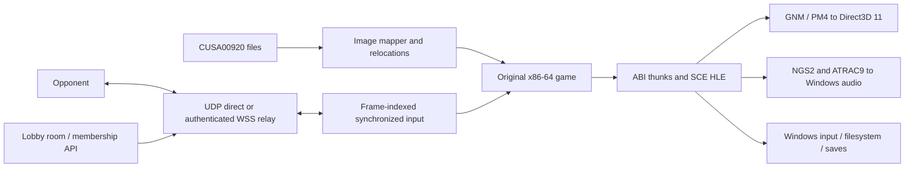

# Runtime architecture

The host maps original PS4 x86-64 instructions and relocations into a Windows
process. Import resolution routes guest calls through ABI thunks into HLE
implementations. Rendering/audio are compatibility services; the game simulation
and match rules remain guest code.

## Online model

The port synchronizes inputs for the original local two-player simulation.
Fresh guest processes start from the same boot path; input frames and PRNG state
are coordinated. Packet authentication/replay rejection protect session
boundaries. Periodic checks compare selected initialized state and room/RNG
progression; they are not a complete game-state serializer.

Room management is an HTTP JSON service with binary WebSocket relay. Direct UDP
uses LAN/STUN candidates and best-effort hole punching. Relay fallback shares the
HTTPS origin, so a Cloudflare Tunnel can expose it without player software or
router forwarding. The tunnel does not expose raw UDP. No full ICE/TURN stack,
recovered PSN matchmaking, rollback or resume is claimed.

## Boundaries

- Rendering-thread work must not wait on lobby HTTP operations.
- Keep operational credentials/config outside source and player distributions.
- Preserve file/ABI layouts and validate guest call-site assumptions.
- Keep local simulation at its intended 60 Hz independently of presentation.
- Use isolated save/config directories for all automated gameplay testing.

See MULTIPLAYER.md for protocol and deployment details and
NETWORK-VERIFICATION.md for tested behavior.
